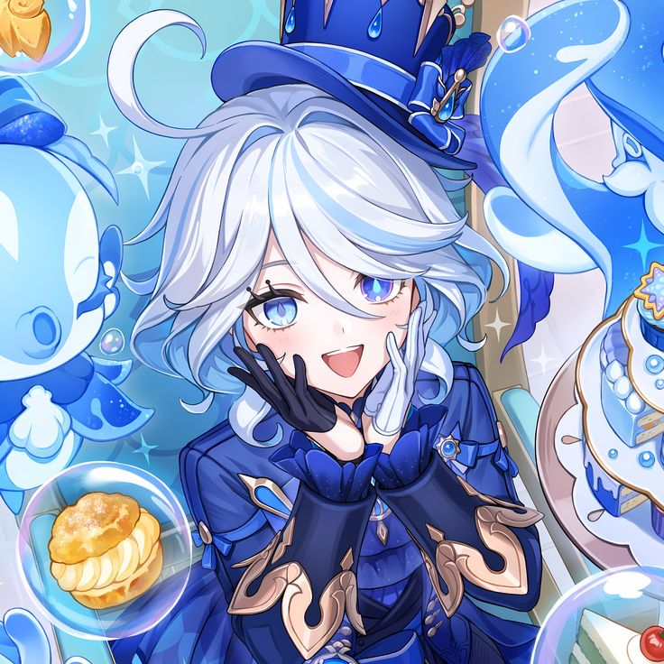

<!-- ═══════════════════════ FONTAINE HEADER ═══════════════════════ -->

  

<table width="100%">
  <tr>
    <td width="68%" align="center" valign="middle">
      
       
      
       
      
      
    </td>
    <td width="32%" align="center" valign="middle">
      
    </td>
  </tr>
</table>

  <em>✨ Every commit deserves its own grand performance. ✨</em>

---

## 🎭 The Performer — About Me

- 🎓 Undergraduate student in Cybersecurity Engineering at Batam State Polytechnic
- 🐍 Exploring Python, Linux, networking, and cybersecurity
- 💧 Interested in Web Security, Network Defense, and Ethical Hacking
- ⚙️ Building projects, breaking things ethically, and learning how to secure them
- ✨ On a journey to become a better Cybersecurity Engineer & Developer

## 💌 A Letter from Fontaine — Connect with Me

  
  
  

---

## 💎 Skill Constellation — Tech Stack & Tools

  

---

## 🎼 The Grand Stage — Featured Projects

<table width="100%">
  <tr>
    <td width="50%" valign="top">
      <h3>❄️ Albis Antique</h3>
      
A cybersecurity-focused e-commerce project built with a Python backend and a focus on secure infrastructure.

      
    </td>
    <td width="50%" valign="top">
      <h3>🪄 PBL 205</h3>
      
Another project from my learning journey in software development and engineering.

      
    </td>
  </tr>
</table>

---

## 📜 The Fontaine Archives — GitHub Statistics

  
  

  

---

## 🎮 The Never-Ending Performance — Galaga Contributions

  <picture>
    <source
      media="(prefers-color-scheme: dark)"
      srcset="https://raw.githubusercontent.com/diyayoon/diyayoon/galaga-output/pacman-contribution-graph-dark.svg"
    />
    <source
      media="(prefers-color-scheme: light)"
      srcset="https://raw.githubusercontent.com/diyayoon/diyayoon/galaga-output/pacman-contribution-graph.svg"
    />
    
  </picture>

  Contribution animation generated with the <a href="https://github.com/abozanona/pacman-contribution-graph">Pac-Man Contribution Graph</a> action in Galaga mode.

---

  <em>“drunk on projects, sober on deadlines”</em>
   
  Thank you for attending my little performance. See you in the next commit! 💧

  

