  

  
  <a href="https://www.instagram.com/mhdyaisha/">
    
  

---

## ✦ About Me

I'm **Mahdiya Aisha (Diya)**, a Cybersecurity Engineering student at **Batam State Polytechnic**. I enjoy exploring how applications and infrastructure work and more importantly, how to make them more secure.

- 🔐 Interested in **Web Security, Network Defense, and Secure Infrastructure**.
- 🐍 Building with **Python** and exploring backend development.
- 🐧 Learning through **Linux, containers, networking, and hands-on security labs**.
- ⚙️ Enjoy connecting software development, DevOps, and cybersecurity in practical projects.

## ✦ GitHub Analytics

  
  

## ✦ Tech Stack &amp; Tools

  

---

## ✦ Contribution Arcade

  <picture>
    <source media="(prefers-color-scheme: dark)" srcset="https://raw.githubusercontent.com/diyayoon/diyayoon/galaga-output/galaga-contribution-graph-dark.svg" />
    <source media="(prefers-color-scheme: light)" srcset="https://raw.githubusercontent.com/diyayoon/diyayoon/galaga-output/galaga-contribution-graph.svg" />
    
  </picture>

